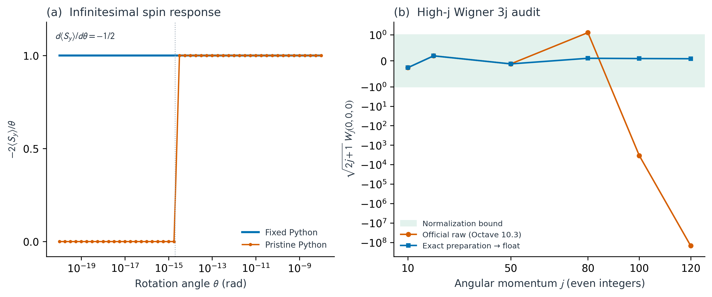

# 角动量、旋转与可靠的标量CG

所有生成器取`hbar=1`，基底为`|j,m>`且m从j降到-j。旋转是主动作用
`U(n,theta)=exp(-i theta n.J)`；自旋or波函数不是只定义到整体相位的Hamiltonian作用群。

```python
import sympy as s
from tbkit.orbitals import angular_momentum, spin_rotation
from tbkit import Qnum, BasisFunc, angular_cg

Jx, Jy, Jz = angular_momentum(s.Rational(3, 2))
U = spin_rotation([1e300, 2e300, -3e300], .7, spin=.5)
psi = BasisFunc({Qnum(0, 0, .5, .5): 1})
small = psi.rotate([1, 0, 0], 1e-20)  # 保留极小但非零的翻转振幅

c = angular_cg(100, 100, 0, 100, -100, 0)  # 精确1/sqrt(201)
value = angular_cg(100, 100, 0, 100, -100, 0, exact=False)
```

## 离散量子数与数值输入

`angular_momentum`要求j恰为非负整数或半整数，不再用相对`isclose`把近似值当作合法j。
例如`j=.500001`旧代码产生2维矩阵，却不满足完整SU(2)对易关系。
这里拒绝该输入；不会偷偷修正它的物理含义。NumPy整数转为安全整数运算，避免倍增溢出。
默认`max_dimension=1025`限制稠密分配，`angular_momentum`、`spin_rotation`和
`BasisFunc.rotate`均可显式调整此预算。

旋转轴必须为有限、实、非零3向量。先除最大绝对分量，再归一化，确保中间范数位于
`[1,sqrt(3)]`，避免整体量级为1e±300时溢出/下溢。角度须是有限实标量，单位rad。
大角度用libm的半角sin/cos稳定约化到SU(2)的4pi周期，不用2pi取模抹掉自旋负号；
小角度直接保留，避免半角下溢和不必要舍入。不能据此恢复输入浮点数已经丢失的精度。

`orbital_rotation`只接受实正交3×3矩阵，绝对正交容差1e-12、相对容差0。
旧`allclose`默认相对容差曾接受`(1+1e-7)*I`并返回非幺正轨道表示；现在明确拒绝。
不会丢弃复数虚部、自动极分解或把不正交输入投影成另一个操作。几何数据若只是近似对称，
调用者须显式处理几何近似，不能把原输入当作精确幺正操作。反演仍受支持。

## 极小旋转与线性响应

`BasisFunc.rotate`不再隐式删除绝对值小于1e-15的旋转元素。
对初态`|up>`绕x旋转，独立算符关系给出

`<S_y> = -sin(theta)/2`，`d<S_y>/dtheta = i<[S_x,S_y]> = -1/2`。

旧截断使足够小的角度返回0，抹掉线性响应。新实现保留每个计算得到的非零元素，
但这仍是数值旋转，不是精确符号三角函数；数值舍入量也不会被暗中删掉。
波函数可以有符号或未归一化系数，默认不擅自归一化/剪枝。

## 标量CG与高j准备

`angular_cg(j1,j2,J,m1,m2,M)`返回Condon–Shortley系数
`<j1,m1;j2,m2|J,M>`。参数次序与SymPy和官方`ClebschGordan`一致，
与官方`CG(j1,m1,j2,m2,J,M)`的次序不同。
无效量子态（负j、非半整数、投影越界/奇偶不符）报错；有效态之间禁止的耦合
（三角关系、总奇偶、M守恒等）返回0。默认返回精确SymPy表达式；`exact=False`
先精确计算再以float64求值，不用浮点阶乘乘积或交错Racah和。

这是按需标量入口，不会为查询高j的一个系数创建完整张量CG矩阵。
既有`coupled_basis(l,s)`仍返回耦合行/未耦合列的完整精确角动量矩阵。
未合并PR #8的有限群`clebsch_gordan`接收表示对象，约定耦合ket列，不能混淆两类接口。
所有量子数须先绑定到离散值；自由参数的算符可乘这些系数继续做符号推导。

固定官方MATLAB数值函数在高j并不可靠：阶乘路径出现Inf/NaN，log-gamma路径仍有
严重的交错消减，甚至违反CG归一化给出的幅值界。本轮只执行原式并记录失效，
没有提交未经充分验证的高j MATLAB候选修复；小j接口修复不等于高j稳定性保证。

## Numba与复用

```python
from numba import njit
from tbkit.angular_kernels import angular_momentum_doubled

@njit
def prepare(two_j):
    # 已校验的非负整数2j，默认稠密维数上限1025
    return angular_momentum_doubled(two_j)
```

该内核只返回complex128数组，可直接组合到用户nopython管线；阶梯系数使用
`sqrt(k*(2j-k+1))`，避免相近大数相减。公共对象层负责离散标签与预算校验。
固定j的生成器应准备一次复用；精确CG也应在准备阶段计算，再将数值数组交给JIT研究循环。
SymPy和SciPy矩阵指数没有因此整体变成nopython算法。

```bash
python -m pytest python/tests/test_angular_invariants.py python/tests/test_matlab_high_j_audit.py -q
python python/examples/angular_audit.py --output work/angular-audit
NUMBA_NUM_THREADS=2 OPENBLAS_NUM_THREADS=1 python python/benchmarks/angular_generators.py
```

例子读取已存档的原始执行快照，输出新结果、公式报告、原始数组和PNG/PDF/SVG。
右图采用对称对数纵轴，阴影为真实归一化界，没有截掉越界值或把Inf/NaN修成有限值。
高j函数原式的具体浮点误差会因库/平台变化；源码提交与执行版本都记录在快照中。


