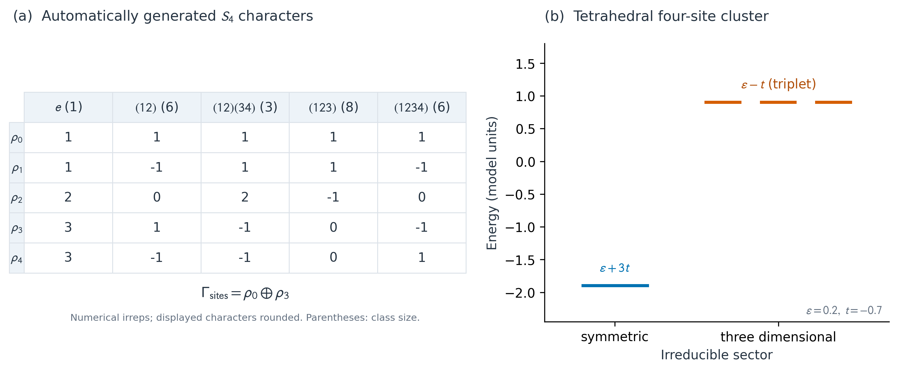
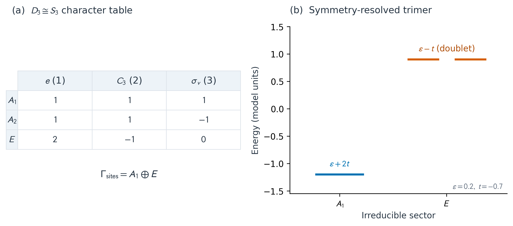

# 有限群、Python抽象接口与普通表示

Python可以实现MATLAB式的基类继承，也可以通过`abc.ABC/abstractmethod`提供更明确的
抽象契约。现有`TBkit(ABC)`已规范数值模型接口；本轮为有限群新增独立的抽象接口。
官方`src/classes/@group/group.m`实际声明为普通`classdef group`，并非`(Abstract)`；
`Oper < group`是继承关系。新实现按Python对象逻辑区分“一个操作”和“整个群”，
不要求一个Oper同时扮演元素、元素数组和群容器。

| 对象 | 职责 |
| --- | --- |
| `Oper` | 对哈密顿量的一次空间/内部/反幺正操作，保留原接口 |
| `AbstractFiniteGroup` | 有限元素、单位元、乘法、逆元的抽象契约；未实现抽象方法时不可实例化 |
| `FiniteGroup` | 带固定元素标签的有限群；以整数Cayley表验证全部群公理 |
| `MatrixRepresentation` | 一个群上的普通幺正线性表示，验证全部乘法关系 |
| `CharacterTable` | 从用户提供的不可约表示建立并验证完整特征标表，供计算及LaTeX展示 |

## 群的基本操作

```python
from tbkit import dihedral_group, cyclic_group, permutation_group

G = dihedral_group(3)       # D_n阶数为2n；这里D3同构于S3
G.order                    # 6
G.identity                 # (0, 0)
G.multiply((1, 0), (0, 1)) # r s；标签(k,b)表示r**k s**b
G.inverse((1, 0))
G.power((1, 0), -2)
G.element_order((1, 0))     # 3
G.conjugacy_classes()      # 类大小1、2、3
G.center()
G.commutator_subgroup()
rotation = G.generated_subgroup([(1, 0)])
reflection = G.generated_subgroup([(0, 1)])
G.subgroups()              # 完整枚举，超max_subgroups则报错，不返回伪完整列表
G.cosets(reflection, side='left')
G.cosets(reflection, side='right')
G.is_normal(rotation)      # True
G.quotient(rotation)       # 实际阶2商群；非正规子群会报错
```

`FiniteGroup(table, elements=...)`中的table使用从0开始的元素索引；标签可以是可哈希对象。
标签顺序不被偷偷重排，单位元也不必是第0项。每行/列为置换、单位元、结合律都要检查，
不能把有单位元和逆元的非结合Latin loop误当成群。
`FiniteGroup.from_group(custom)`可验证符合抽象接口的用户扩展，拒绝声明与实际乘法矛盾的逆元。
循环群、D_n、置换生成群和从严格矩阵乘法生成群均有构造接口。

此层显式存储O(|G|²)乘法表，结合律检查为O(|G|³)，主要面向小有限群及点群。
置换/矩阵生成有max_order边界，子群数也有显式上限；不是大型置换群的Schreier–Sims替代品。

## 普通表示与精确符号

```python
import sympy as s
from tbkit import MatrixRepresentation, CharacterTable

r = s.Matrix([[-s.Rational(1, 2), -s.sqrt(3)/2],
              [s.sqrt(3)/2, -s.Rational(1, 2)]])
mirror = s.diag(1, -1)
A1 = MatrixRepresentation(G, [s.eye(1) for _ in G], name='A_1')
A2 = MatrixRepresentation(G, [s.Matrix([[(-1)**b]]) for k,b in G], name='A_2')
E  = MatrixRepresentation(G, [r**k * mirror**b for k,b in G], name='E')
table = CharacterTable([A1, A2, E])
print(table.values)         # [[1,1,1], [1,1,-1], [2,-1,0]]
print(table.latex())
E.tensor(E).decompose([A1, A2, E])  # (1,1,1)
```

SymPy矩阵默认保持精确，整数、Rational、根号和复相位不变成浮点数；显式exact模式
拒绝Float原子，不用nsimplify猜测原始模型。参数化矩阵只有在给定假设下能证明全部
关系时才接受，数值化前须用`as_arrays(parameters=...)`绑定参数。
绑定后会重新验证幺正性与乘法关系，拒绝违反原符号假设的取值。
NumPy输入使用显式容差验证，不将数值近似称为精确群论证明。

每个表示满足`D(a*b)=D(a)D(b)`和幺正性。不同表示必须共享同一个带索引的群对象，
不根据“看起来同构”而猜测元素对应。`characters(by_class=True)`返回每个共轭类的特征标；
`inner`、`multiplicity`、`decompose`用于正交性和重数。`CharacterTable`检查共轭类数、
不可约性、行正交性与`sum d**2=|G|`；可以传入精确不可约表示，也可显式使用下节的数值生成器。

`frobenius_schur()`仅用于irrep：+1实型、0复型、-1四元数型。例如C3的复一维表示为0，
Q8的二维表示为-1。这不等于已经实现完整的反幺正Wigner核心表示。

## 自动生成普通复不可约表示

```python
from tbkit import irreducible_representations

G = dihedral_group(4)
irreps = irreducible_representations(G, max_order=64,
                                    tolerance=1e-9, spectral_tolerance=1e-8)
[r.dimension for r in irreps]       # 四个一维表示与一个二维表示
table = CharacterTable.from_group(G)  # 同样生成并验证完整数值表
G.regular_representation().decompose(irreps)  # 每个irrep的重数等于其维数
```

生成器以`L(g)|h>=|g*h>`的正则表示为起点。共轭类平均在每个等型空间上为标量，
将它们的两个Hermitian分量逐步联合分解，得到维数`d_alpha**2`的空间；
再用与左作用对易的右正则作用，在重数空间中取一个`d_alpha`维副本。
两个Hermitian分量都要保留，不能只对称化类平均：C3/A4的复共轭表示必须不同，
Q8的四元数型表示在复数域中仍是二维，不能误分成一维或当作四维实表示。

返回值是`exact=False`的`complex128`表示。全部乘法关系、幺正性、不可约性、行正交、
共轭类数及维数平方和都会检查后才返回。它们是显式容差下的数值证据，不是符号证明。
原有精确SymPy输入与符号投影保留；不会用`nsimplify`猜测浮点结果的“精确根式”。
行名`rho_i`是通用标签，不自动声称Mulliken物理命名；简并空间的基底也不唯一，
不能以两个平台输出的矩阵逐元素不同判定表示不等价。

`max_order`默认64，先检查再分配正则作用的稠密准备数据。这个算法面向小有限群，
不是大型置换群或无限群的算法。`spectral_tolerance`用于范数不超过1的分裂算符，
相邻谱隙在阈值的1到10倍间视为歧义并报错；未分清中心、重数不符合平方数、
表示校验失败时同样抛出`IrrepGenerationError`，不返回半张表。
`tolerance`用于最终表示与字符关系检查。若修改这些阈值，应重新检查已知群和误差。

Numba内核`group_kernels.regular_blocks(table, Q)`直接计算`Q† L(g) Q`，避免构造
全部正则矩阵，可在用户`@njit`管线中调用。它接受已验证的数组；符号化简、
谱分解与群对象流程仍在Python/NumPy/LAPACK层，不宣称整个生成器都被JIT编译。

```bash
python -m pytest python/tests/test_automatic_irreps.py -q
python python/examples/automatic_irreps.py --output work/automatic-irreps
NUMBA_NUM_THREADS=2 OPENBLAS_NUM_THREADS=1 python python/benchmarks/regular_blocks.py
```

四站点例子使用正四面体上的无自旋标量轨道和全部相等的实跃迁，完整Td作用同构于S4。
自动识别对称单态和三维扇区，解析能量为`epsilon+3*t`与三重简并的`epsilon-t`；
用SymPy独立推导哈密顿量和解析基底，并验证数值投影及三重态的复幺正换基不变性。
输出原始复数表示/字符/投影、JSON、LaTeX/Markdown和PNG/PDF/SVG。
示意表仅将显示副本舍入，原始数值数组不被修改，数值表示不因此变成精确表示。



## 投影、重数与简并子空间

`target.projector(irrep)`给出中央等型投影

`P_alpha = d_alpha/|G| * sum_g conj(chi_alpha(g)) D_target(g)`。

其秩是“重数乘irrep维数”，保留所有等价副本；不自动分开重数空间，也不选择唯一基底。
支持精确SymPy与NumPy/Numba数组实现。`tensor`、`direct_sum`及`restrict(subgroup)`支持
张量积、直和及子群限制。

`on_subspace(Q)`中Q的列是正交归一基，并且必须在群作用下封闭。返回该子空间上的
整块表示；换一组子空间基只做相似变换，不改变特征标。
不能把任意简并本征矢下的逐带对角期望值当成对称本征值；后者需要对称算符在简并块内的
谱分析，或使用整块特征标/投影判定。用于Bloch能带时还必须先构造同一k的小群并提供正确sewing，
这里不自动恢复hr.dat中缺少的位置矩阵或处理k依赖投影表示。

## 整体相位、双群与反幺正操作

现有`finite_group`为`U H U†`闭包忽略整体相位，适合哈密顿量平均。这是作用群的商集，
**不能直接当成Hilbert空间的普通表示群**。例如自旋旋转`U=diag(-i,i)`作用于H的阶数为2，
而`U**2=-I, U**4=I`，保留相位的矩阵群阶数为4：

```python
from tbkit import matrix_group
spinor = matrix_group([s.diag(-s.I, s.I)])
spinor.group.order    # 4
spinor.characters()  # (2,0,-2,0)
```

`matrix_group`不按整体相位合并元素；这可表达已给定矩阵生成元的有限中心扩张，
不等于已经自动构建所有晶体双群/因子系统。反幺正`UK`的U在基底变换下是合同变换，
其普通迹不是不变量。`MatrixRepresentation.from_operators`因此拒绝antiunitary操作，
不把它们冒充普通特征标或普通irrep投影。

抽象群可以取商，不代表给定的Hilbert表示必然能降到商群；只有被商子群中的元素
在该表示中均作用为I，才能直接下降为普通表示。不能用取商操作悄悄删除自旋的-I。

## Numba与展示示例

`group_kernels.associative`和`group_kernels.character_projector`接受纯数组，可在用户
`@njit`中调用。群表与表示验证、符号化简在准备阶段完成；应把算好的投影或数值数组
复用于研究热循环。没有跨模型可变全局缓存，也不宣称所有符号操作会被Numba加速。

```bash
python python/examples/group_theory.py --output work/group-theory
python -m pytest python/tests/test_group_theory.py python/tests/test_matlab_group_audit.py -q
```

示例精确推导无自旋等边三站点紧束缚模型的`A1+E`分解，验证`epsilon+2t`单态与
`epsilon-t`双态，并导出字符表、Cayley表、投影、基底和哈密顿量的LaTeX/Markdown，
以及PNG/PDF/SVG和原始数组。LaTeX源文件导出不等于已编译文档PDF；Jupyter接口也不等于
已运行所有前端。由于绘图PR尚未合并，例子使用独立局部样式，合并后可接入公共样式。



最小生成元/群秩及同构/自同构算法、精确代数数域irrep自动生成、Clebsch–Gordan系数/重数基底、
反幺正核心表示、投影表示因子系统、
完整空间群小群及无限/Lie群仍待继续实现。MATLAB基类审阅和候选补丁证据见
[audit/GROUP-REVIEW.zh-CN.md](audit/GROUP-REVIEW.zh-CN.md)。
