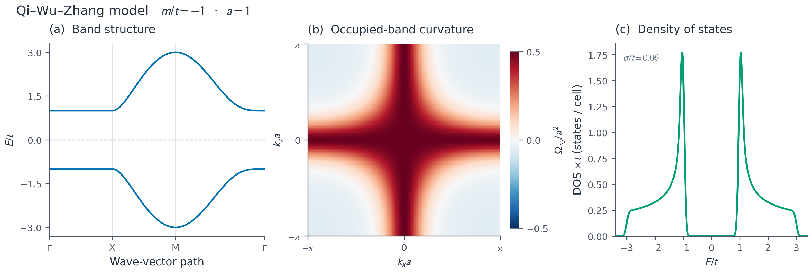

# 科学绘图规范与可复用样式

pyTBkit 的默认图形应清晰、克制、美观，在论文实际尺寸下可读。字体、公式、
线宽、颜色、图例和留白共同设计；物理含义与数据真实性是前提。

## 使用

```python
import matplotlib.pyplot as plt
from tbkit.plotting import plot_style, bandplot, save_figure

with plot_style('paper'):  # 'presentation' 用于报告的大字号
    fig, ax = plt.subplots(figsize=(4.2, 3.2))
    bandplot(distance, energies, ticks=path_ticks,
             labels=[r'$\Gamma$', 'X', 'M', r'$\Gamma$'],
             ax=ax, reference=0, ylabel=r'$E/t$')
    ax.set_title('Band structure')
    save_figure(fig, 'work/figures/bands')
plt.close(fig)
```

- `plot_style` 是局部 rc_context，退出后恢复用户设置；import 不改变全局风格。
- 采用 Matplotlib 随附字体和 MathText，无需下载字体或安装商业/外部排版工具。
  可按自己的出版规范覆写，例如 `plot_style(**{'font.size': 11})`。
  中文标签需要用户系统中可用的中文字体，并显式指定 `font.sans-serif`。
- `bandplot` 仍返回 Axes，保留现有接口；支持 `color/c`、`linewidth/lw` 等显式属性。
  密集能带默认统一蓝色；多个物理通道可使用公开的 `PALETTE` 选择颜色，并配合线型。
- `save_figure` 默认导出300 dpi PNG、PDF、SVG，保留矢量文字与曲线；大热图可以
  显式 `rasterized=True`，避免矢量文件膨胀。SVG文字保留为text，PDF嵌入TrueType字体。
  导出不关闭图，也不自动显示。

## 每类图的验收要求

1. **能带**：高对称点用数学符号，路径分段有轻分隔线；能量单位和参考明确。
   参考线默认不画，`reference=...` 只标线，不执行能量相减。绝对DFT能量保持原值。
2. **曲率/自旋等有符号场**：采用以零为中心的发散色图，展示色标与单位。
   默认示例使用对称范围覆盖全部数据，不把绝对值当原有符号量，也不隐式截断极值。
   非负密度/权重则用感知更均匀的顺序色图，如viridis/cividis。
3. **DOS/响应曲线**：明确归一化、温度或展宽，少量通道用可区分颜色和线型；
   图例不压住关键峰或交叉点。DOS例子以积分态数校验每胞归一化。
4. **多面板**：统一字号、编号、坐标对齐与单位；标题说明对象和参数，长推导放图注。
   不使用与数据无关的渐变、装饰阴影或密集网格。
5. **数据保真**：不自动平滑、不改变能带排序、不补NaN/掩码断点、不默默丢掉复数虚部。
   展示窗口或颜色截断应显式给出，并在图注解释。
6. **导出审阅**：实际检查PNG，确认公式/单位不缺字、图例不遮挡、没有裁切；
   保存矢量版本，在论文最终缩放尺寸下检查文字和线条。

## 可运行图例

```bash
python python/examples/plot_gallery.py --output work/plot-gallery
python python/examples/research.py
python python/examples/external_data.py --output work/python-external-data
python -m pytest python/tests/test_plotting.py -q
```

图集同时展示QWZ模型的能带、占据带Berry曲率与DOS；归一化取每胞两条能带、
`a=1`、`t=1`，DOS高斯展宽为`0.06 t`。原始数据和实际色标范围随图保存，
不根据视觉效果更改物理计算。热图栅格化，坐标、标签和曲线保持矢量。



这是一套基础风格与示例，不是全部原TBkit绘图API已迁移的声明。符号推导图、
轨道/自旋纹理、Wilson谱和输运多通道图应继续逐类迁移、实际渲染并审阅。
