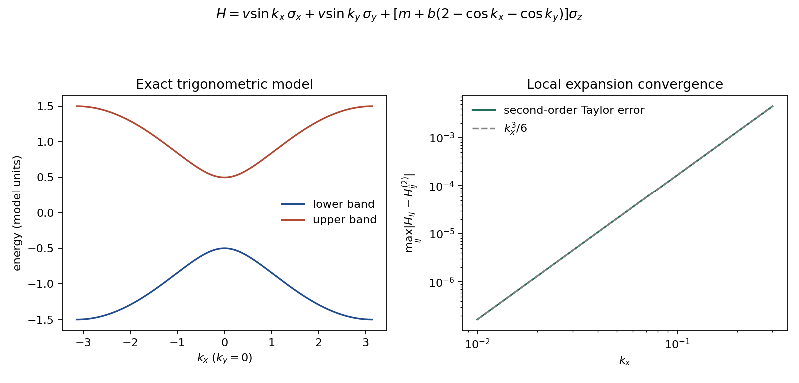

# 符号建模、解析推导与科学展示

这是 pyTBkit 的核心产品能力。优化数值内核时应保留原 TBkit 中用于推导、教学、
展示和论文呈现的功能。SymPy 已是必需依赖；不能把安装 SymPy 或能够调用
`HK.from_sympy` 当作已经完成符号功能迁移。

## 符号与数值对象

`SymbolicHamiltonian` 保存不可变的 SymPy 矩阵、实动量变量和未绑定参数。
整数、Rational、sqrt 和复相位可保持精确；已有浮点数不会擅自恢复成有理数。
它与数值 `TBkit` 对象分开，直到用户显式 `to_hk` 或 `compile`：

```python
import sympy as s
from tbkit import SymbolicHamiltonian

kx, ky, m, v = s.symbols('k_x k_y m v', real=True)
h = SymbolicHamiltonian(
    [[m, v*(kx-s.I*ky)], [v*(kx+s.I*ky), -m]], (kx, ky))
print(h.parameters)           # (m, v)
print(h.pretty())             # 终端公式
print(h.latex())              # 矩阵 LaTeX
h                            # Jupyter 中显示公式（前端需要支持数学渲染）
h.pauli_decomposition()       # 可独立展示的 Pauli 系数与公式
vx = h.derivative(0)          # dH/dkx；尚未除 hbar
numeric = h.to_hk({m: s.Rational(1, 2), v: 1})
energy = numeric.bands([[.1, .2]], backend='numba')
```

可用操作包括模型相加、标量乘法、dagger、subs、simplify、expand、collect、rewrite、
任意整数阶动量导数，以及多变量**总阶数** Taylor 展开。标量能量平移必须显式写成
`scalar*eye(n)`，不把对每个矩阵元加数和加单位矩阵混为一谈。

`subs` 默认同时替换，支持 `kx↔ky`；返回新对象，原模型不变。
`polynomial_terms()` 返回精确系数矩阵，`pauli_decomposition()` 使用
`Tr(B H)/n`，左侧张量因子在前，不预设哈密顿量厄米。

## 从周期符号模型得到局部模型

```python
sx = s.Matrix([[0, 1], [1, 0]])
sy = s.Matrix([[0, -s.I], [s.I, 0]])
sz = s.diag(1, -1)
lattice = SymbolicHamiltonian(
    s.sin(kx)*sx + s.sin(ky)*sy + (m+s.cos(kx)+s.cos(ky))*sz,
    (kx, ky))
kp = lattice.taylor(2)  # 原点总阶数 <=2；坐标仍为原来的 k
# point=(kx0, ky0) 可在其他实点展开，结果用 (k-k0) 的等价多项式表示。
compiled = lattice.compile({m: -s.Rational(1, 2)})
energy = compiled.bands([[.1, .2]], backend='numba')
gradient = compiled.gradient([[.1, .2]], backend='numba')
```

`compile` 在准备时绑定参数、生成标量代码并执行公共子表达式消除；每批 k 点在
Numba nopython 内求值。首次调用仍需 JIT，没有持久编译缓存，也没有 object-mode
静默回退。常数与零矩阵元保留一致布局。支持范围由 NumPy 打印器和 Numba 决定；
未实现的特殊函数可能明确编译失败。任意符号表达式并非都可自动编译。

多项式研究模型优先 `to_hk`，以使用现有高效数组内核；一般三角表达式可用
`compile`。两条路径都提供 `bands/gradient` 接口。`backend='numpy'` 为逐点参考路径，
不承诺此路径适合大批量性能。`HK/Htrig.to_symbolic` 提供可编辑矩阵视图，
已有数值系数保留浮点，视图不携带晶格/轨道元数据。

## 精确对称性与展示

```python
from tbkit import Oper, invariant_kp
c4 = Oper((s.eye(2)-s.I*sz)/s.sqrt(2), s.Matrix([[0,1],[-1,0]]))
residual = h.symmetry_residual(c4)
# 输出确切允许项，保留根号、相位和可读公式；原默认仍返回数值 HK。
basis = invariant_kp(2, 2, 2, [c4], output='symbolic', coordinates=(kx, ky))
a = s.symbols(f'a0:{len(basis)}', real=True)
family = sum(coefficient*term for coefficient, term in zip(a, basis))
```

`Oper` 的约定是 `T[H](k)=sign*U*H(Rk)^(*)*U†`，`R` 是输入动量作用。
反幺正变换要取复共轭，反对称操作要乘负号；不通过多翻一次 k 来补偿。
`Oper.latex()` 展示这个约定和具体矩阵。当前符号变换只支持常数表示，
不支持一般依赖动量的 Bloch sewing。数值 SVD 的结果不能伪装为精确符号基。

参数的 `real/positive` 等假设由用户给出；`is_hermitian()` 返回 True/False/None，
假设不足时的 None 不能视为通过。数值能带路径仍检查厄米性。
`Qnum/BasisFunc` 提供量子态标签及线性组合的 LaTeX/Jupyter 展示，
`BasisFunc.subs` 可在保持标签的同时替换符号系数。

## 示例、导出与验证

```bash
python python/examples/symbolic_workflow.py --output work/symbolic-example
python -m pytest python/tests/test_symbolic_workflows.py -q
python python/tools/inventory_symbolic.py --check
```

示例输出精确矩阵、Pauli 分解、导数、Taylor 模型、操作和量子态公式的 Markdown
与独立 LaTeX 文档，以及能带/局部误差收敛 PNG 和数值数据。LaTeX 文件导出不等于
PDF 已编译；有 TeX 工具链时在输出目录运行 `pdflatex symbolic-report.tex`。
Jupyter 是可选交互前端，CLI 示例不需要安装 Jupyter。

以下是该脚本生成并实际检查过的示例图；可下载
[LaTeX 示例源文件](examples/assets/symbolic-report.tex) 并在同目录编译。



独立验证采用解析两带能谱、Taylor 误差阶、精确 Pauli 重构、时间反演/粒子空穴/
C3/C4 条件；Numba/NumPy 一致性之外还有物理和解析判据。没有在缺少 MATLAB
许可证的情况下声称完整 MATLAB Symbolic Toolbox 对照已运行。

## 官方源功能盘点与待迁移清单

源固定为 BUAA-TCMP/TBkit @ `48e5217593598c8e1d634cdee3976e1dc6984516`。
可重建的 [源码索引](audit/symbolic-source-inventory.json) 在880个 `.m` 文件中找到
252个包含符号/呈现关键词的候选文件；这是保守词法扫描，**不是功能完成比例**。
完整注释行已排除，行内注释和字符串仍可能命中，动态调用可能漏掉。

| 官方功能入口/用途 | 本轮状态及接续要求 |
| --- | --- |
| HK.Hk_sym/Hk_latex、sym/subs/simplify | 精确矩阵模型与对应操作已建立；完整原类编辑工作流尚未逐项迁移 |
| Htrig.Htrig_sym、rewrite、latex、Htrig2HK | 一般三角符号表达式、改写、总阶数展开与编译已有；结构化符号频率/系数表及双向转换待补 |
| HR 符号 HcoeL、charalize/printout、HR2HK/HR2Htrig | 数值路径已有；含自由跃迁参数的实空间存储、编辑与符号转换闭环待实现 |
| HK/Oper 对称性建模 | 常数精确表示、反幺正约束及精确允许项输出已有；一般空间群符号 sewing、磁群和表示流程待补 |
| pauliDecomposition/GammaDecomposition | 精确 Pauli 张量基与重构已有；原 Gamma 基定义、标签及对应表待迁移，不能仅用 Pauli 名称替代 |
| Qnum/BasisFunc/Y_lm/Y_l__m | 精确量子数、角向球谐/CG、标签展示与线性态已有；符号旋转、径向函数、原组合/化简/展示工作流未完整迁移 |
| 群表示、特征标、不可约表示投影 | 数值/常数群操作只是基础；符号表示表、投影证书与可读展示需单列实现和验证 |
| Oper/Spin/BasisFunc 的 pretty/disp/latex | 操作与基态公式展示已有基础；全部原类显示、表格及群关系可视化仍待迁移 |
| matlabFunction 与解析公式数值化 | 参数绑定、CSE、Numba/NumPy 编译已有；稳定独立源代码导出和版本化符号持久化待实现 |
| 展示例子、轨道/自旋纹理和研究图 | 新增符号报告与收敛图；已有数值绘图不等于原全部绘图功能已迁移，需逐例对照补齐 |

接续开发应同时验收“表达式正确”“参数可编辑”“公式可呈现”“数值化可复现”，
不能仅以最终能带图相似或数值测试通过代替符号功能完成。
