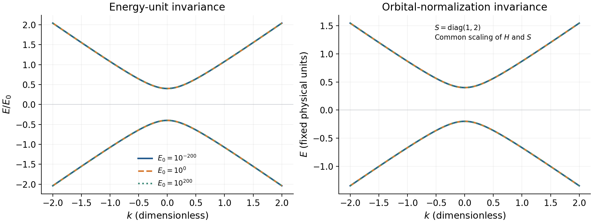

# 厄米性检查的单位、基底与批处理审计

Python 基线：远端 main `13a5832df636c68839b59859adbc330567a02121`。
唯一官方 MATLAB 基线：BUAA-TCMP/TBkit @
`48e5217593598c8e1d634cdee3976e1dc6984516`，不更新 pin。
本分支基于 main；尚未合并的符号、群论等 PR 单独记录组合验证，不能视为 main 已有功能。

## 已先执行的 Python 物理反例

原始共享检查使用 `np.allclose(H,H†,atol=1e-10,rtol=1e-10)`；
稀疏检查另用固定 `max(abs(H-H†))<=1e-10`。
设 `H=E0*[[0,i],[i,0]]`。特征多项式为 `lambda²+E0²`，
真实本征值是 `±i E0`，不属于厄米能带求解器的定义域。
原始 `HR.bands` 在 `E0=1` 时拒绝，在 `E0=1e-20` 时接受并返回 `±E0`：
`eigvalsh` 只读一个三角形，错误数据因此得到虚假的实谱。
不能以“本征值是实数”或“NumPy 没报错”证明输入厄米。

另设 `H=c*diag(1,2)`、`S=c*[[1,.4i],[0,1]]`。
普通非正交轨道的重叠矩阵必须是正定厄米 Gram 矩阵。原始程序在 `c=1` 时拒绝，
在 `c=1e-20` 时接受并返回 `[1,2]`。共同缩放 H、S 相当于所有基矢乘 `sqrt(c)`；
有效性不应因这种归一化变化而改变。这不是在为不定度量的玻色 BdG 定义谱 API。
原始文件 hash、输入和观测记录在 `hermiticity-python-pristine.json`。

## 新的明确判据

对每个矩阵独立检查

`||H-H†||_F <= atol + rtol*||H||_F`，默认 `atol=0, rtol=1e-10`。

Frobenius 范数满足 `||U† A U||_F=||A||_F`；因此判据在精确算术下对幺正基底旋转
与共同能量缩放不变。浮点实现仅在舍入误差内保持这些性质。各 k 点、各导数分量分别
检查，不能由一个大能量矩阵设置整个 batch 的尺度。零矩阵有效。默认没有隐含能量单位，
也不暗中补共轭项或厄米化。

`hermitian(H, atol, *, rtol=...)` 保留显式第二位置参数，但 atol 现在是**矩阵
Frobenius 缺陷**的绝对上界，不再是旧 `allclose` 的逐元素阈值；两种语义不可混称。
`rtol=0, atol=0` 要求精确共轭相等；绝对检查在缺陷自身尺度计算，保留巨大对角项旁
的微小非对称。显式 atol 具有输入单位，非零 atol 本来就不满足单位缩放不变性。
容差必须是有限非负实标量，布尔值也拒绝。

实/虚分量先分别缩放，避免有限 `1.7e308+1.7e308i` 的复数模溢出，以及微小实数
的复数除法倒数溢出。缺陷再缩放后平方求和，避免将可分辨的小缺陷平方成零。
Numba 内核用每矩阵 scratch 数组复用归一化分量，普通尺度用安全倒数乘法，
次正规尺度保留直接实数除法；不启用 fastmath。
`validation_kernels.hermiticity_metrics` 是可被用户 `@njit` 调用的纯数组内核。
它只接收已验证的有限 `(batch,n,n)` complex128 数组；Python 包装负责形状和有限值检查。
近浮点边界的默认判定仍有舍入误差；精确模式直接比较原始分量差，不由缩放后的零推断精确性。

稀疏路径复制为 CSR、合并重复项、验证有限性，再在归一化数据上计算稀疏共轭差，
不稠密化、不改原输入，存储量 O(nnz+n)。稠密和稀疏都在厄米求解器运行前拒绝错误。
非正交 H/S 与 dH/dS、共享谱导数等现有调用获得同一判据；原有正定 S 检查保留。

## 独立验证与边界

- `H=E0*(2 sz - sy)` 的解析能谱 `±sqrt(5) E0`，NumPy/Numba 能带后端分别验证。
- `H=E0*i sx` 的非实谱反例，稀疏测试确认错误矩阵不会到达 ARPACK。
- `H=c*diag(1,3), S=c*diag(2,4)` 的能谱恒为 `[1/2,3/4]`；非厄米或不定 S 均拒绝。
- `H(k)=H0+k*i sx` 在 k=0 偶然厄米，导数仍必须拒绝；包含普通谱快照和广义带梯度。
- 缩放从 `1e-200` 到 `1e200`，随机复幺正旋转、混合尺度 batch、chunk 分割、
  次正规数、有限极大复分量、显式绝对阈值、稀疏重复项及十万维稀疏单位阵。
- Numba 内核的缺陷比值与独立 NumPy 范数对照，并真正从另一个 `@njit` 函数调用。

默认相对判据是对整个矩阵的后向误差门槛，不能保证任意微小劈裂或曲率精度。
巨大整体能量偏置、很不均匀的子块尺度仍可能使小缺陷落在容差内；这里不宣称能量零点
移动不变，也没有证明任意非幺正基底变换的数值条件不变性。研究小能隙时需显式收紧
检查并做精度/收敛研究。严重病态正定 S 的条件数诊断、非正交 Berry 连接、
简并阈值的量纲、所有剩余模块各自的绝对阈值，仍需后续审计。

## 官方 MATLAB：原始表达式级特征，不是完整类认证

原始 `@HR/EIGENCAR_gen.m` 的 list/tensor 及轨道规范路径（243/253/349/358 行）
直接执行 `Sout=(Sout+Sout')/2`，265/376 行使用一般广义 `eig(Hout,Sout)`。
专项测试从固定原始文件抽取并在 Octave 执行这两个真实表达式，无候选修复参与。
没有执行完整 HR 类、Symbolic Toolbox 或 MATLAB 运行时。

对上面的三角 S，投影得到 `[[1,.2i],[-.2i,1]]`，特征多项式从
`(E-1)(E-2)` 改成 `.96 E²-3E+2`。这是改变问题，而非验证原始数据。
对 `S=diag(1,-1)`、`H=diag(1,2)`，一般广义求解器给出实数 `[-2,1]`，
但有负 Gram 范数；实数结果不证明它是合法普通轨道重叠。
一般不定矩阵铅笔求解本身不是错误；问题在于将其当作普通非正交轨道谱而缺少定义域约束。
这是普通 Gram 物理域下的缺失保护和投影行为记录，不泛称所有不定广义问题都应禁止。
本轮不添加未经过完整类验证的 MATLAB 补丁，原始参考与已有候选补丁仍分离。

## 可运行研究例子与复现

```bash
export PYTHONPATH="$PWD/python" NUMBA_NUM_THREADS=2 OPENBLAS_NUM_THREADS=1
python python/tools/prepare_upstream.py
python -m pytest python/tests/test_hermiticity_scale.py python/tests/test_overlap_source_audit.py -q
python python/examples/hermiticity_units.py --output work/hermiticity-units
python python/benchmarks/hermiticity.py
python python/tools/validate.py --output work/hermiticity-validation --benchmarks
```

环境重建遵循仓库 `python/install.sh`；不安装商业 MATLAB。
例子独立验证有隙两带色散和正定 S 的二次方程，输出 PNG/SVG、数值误差与拒绝计数。
两图的能量缩放和共同 H/S 归一化是不同操作，坐标明确区分。
Numba 基准先过独立误差检查，分别记录无缓存新 dispatcher 编译+首次调用、预热5次
中位数、包装校验耗时、线程与种子；不把内核倍率称为全工具包或对 MATLAB 的加速。
实际报告在 `hermiticity-validation.json`、`hermiticity-benchmark.json`；
接续事项与组合验证记录随本轮结果更新，不能以这些测试通过声称全库迁移完成。


## 本轮实际结果（2026-11-17）

独立分支：179 项测试，失败/错误/跳过均为0；12 个验证步骤通过，包括全部原有
例子、Fortran/Octave 对照和4个基准任务。38 项是本轮新增回归。
原始表达式级 Octave 测试通过意味着复现了投影/不定度量行为，并非认证其物理适用性。

临时组合 PR #2–#9 后：338 项测试、25 个步骤全部通过，含8个基准任务。
另有1条 Matplotlib/Pyparsing 依赖弃用警告，无数值警告。组合过程中6个共享文件
手动保留各分支功能与验证任务；使用的完整 head SHA、处理策略和新代码 hash 记录在
`hermiticity-integration-validation.json`。测试后临时工作树已恢复干净，没有合并远端分支。

例子的最大相对能谱误差为 `3.8983e-16`；三个尺度的错误 H/S 全部拒绝。
PNG/SVG 已实际检查并调整标注，原始数组可由例子重新生成。

完整验证内的基准：新 dispatcher 编译+首次调用约1.43秒；两个负载的预热 Numba
诊断约2.97/6.02毫秒，NumPy约4.78/6.80毫秒；比值误差上界约 `7.55e-15`。
后续独立复测保存在 `hermiticity-benchmark-followup.json`：4096×8 为2.02/4.00毫秒，
32×128 却为90.09/7.21毫秒，出现明显墙钟时间波动。不能据此声称可靠固定倍率，
也不删除慢的结果。两次均固定 Numba 配置2线程、BLAS1线程，内核本身串行；
当前云端未隔离其他 CPU 负载。仍需在稳定资源上研究大矩阵调度、矩阵布局与缓存，
再决定统一后端策略；“可接 Numba”不代表每个负载必然更快。


