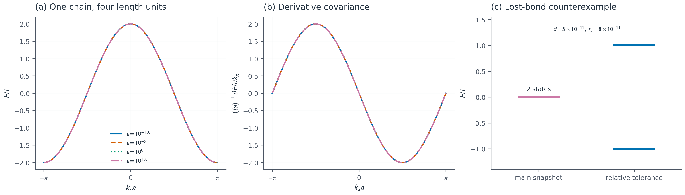

# 晶格长度单位、近邻图与共享 Bloch 基底审计

Python 基线为远端 main `a1f1102356d4efb8df50d7bf4bc70810adf5a38f`。
开始时无未合并 PR。唯一官方 MATLAB 源仍是 BUAA-TCMP/TBkit @
`48e5217593598c8e1d634cdee3976e1dc6984516`；不更新 pin，不新增 MATLAB 候选补丁。

## 原始 Python 的独立反例

原始 main 文件逐一比对内容 hash 后执行，数据见 `lattice-python-pristine.json`。

1. **两轨道谱被固定长度容差改变**：单位晶胞中两原子距离 `5e-11`，cutoff=`8e-11`，
   不周期，s–s 跃迁 t=1。物理矩阵是 `[[0,1],[1,0]]`，闭式谱 `[-1,1]`。
   原始 neighbors 的绝对 tol=`1e-10` 丢弃全部键，SK 建模后实际返回 `[0,0]`。
   这里所有数值都可以正常表示，并非本征求解器精度问题。
2. **共享晶格默认 allclose 合并了不同 Bloch 函数**：两个一维链的 a 分别为1和
   `1+1e-7`，各自 H(k)=2cos(ka)。原始模型相加误把两者的整数 R 合并到第一个晶格。
   取 k=`pi*10^7`，两个函数的和是0，合并后的 HR 却返回4。这个大 k 是放大周期
   不一致的解析反例，不是推荐的材料采样区域；在小 k 的微小误差也可能影响小劈裂。
3. **构造器按有量纲行列式判断可逆**：HR 的 `1e-14`、Structure/SparseHR 等的
   `1e-12` 阈值使同一良态晶胞换成较小长度单位后被拒绝，例如 `1e-6*I`。
4. **SK 方向还保留了未缩放 norm**：有限非零 `(1,2,-3)*1e-200` 被当零键，
   `1e200` 量级则因 norm 溢出而无法得到合法旋转。角向跃迁矩阵不应依赖长度单位。

## 物理约定和不变量

实晶格向量是 A 的行，整数像标记 r 对应 Cartesian 位移 `r@A`。
倒格矢为 `B=2*pi*A^(-T)`，满足 `A@B.T=2*pi*I`。若所有长度乘正数 alpha，
同时 `k_cart -> k_cart/alpha`，则 `exp(+i k.R)` 和能谱不变，
`dH/dk_cart -> alpha*dH/dk_cart`。本轮未将导数冒称已经除 hbar 的速度。
分数坐标、整数 R 不变；Htrig 的 Cartesian frequencies、cutoff 和显式长度容差
也需要同单位变换。距离依赖 SK 回调须自行一致变换参数单位，不由工具猜测。

晶胞体积按 `alpha^d` 变换。BZ average 无量纲；`states` 是
`integral d^d k/(2*pi)^d`，对常数1等于 `1/volume`，不是每胞平均。
`integral` 的测度是 `(2*pi)^d/volume`。归一化和物理响应的散射/电荷/hbar系数仍分开。

## 修改和兼容边界

- 新 `lattice.py` 共用有限实矩阵检查、倒格矢、对数体积与同胞基比较。
  在临时分量缩放后用相对 SVD 阈值 `eps*dimension` 判定数值秩，不再给行列式规定
  隐含长度单位。保留原晶格值、手性和方向，不厄米化、正交化或改变坐标。
  极端病态但形式可逆的胞也可能明确拒绝；这不是任意条件数下的前向精度认证。
- HR/SparseHR/Htrig/Hckt/Structure 构造、kmesh/BZ 几何及相关调用接入共同规则。
  矩阵逆用归一化矩阵求解再恢复单位，倒格矢不能有限表示时明确报错。
- H/S、数值模型相加、direct_sum、晶体 sewing 检查和对称化的共享晶格判据改为
  默认 `1e-12` 的相对 Frobenius 比较，没有绝对长度地板。
  它要求相同的行基底与共同单位；物理等价的旋转、整胞重标记或不同单位须显式转换。
  原来被宽松 allclose 接纳的模型现在可能报错，这是有意的物理域收紧。
- neighbors 的默认 `tol=None` 表示 `1e-10*cutoff`；**显式 tol 仍是绝对长度**。
  KD-tree 在 cutoff 单位中搜索，避免在物理坐标上平方导致上下溢。
  保留原未包裹分数坐标和 R 标签；公共原点平移不等于把原子重新包回晶胞。
  返回满足 `tol<distance<=cutoff+tol` 的所有有向键。默认仍有明确的分辨阈值，
  极短键相对极大 cutoff 的研究可显式 tol=0，前提是输入坐标本身能分辨它。
- 重复原子像在分配前受 `max_images=2_000_000` 预算限制，计数使用 Python 整数。
  超限报 MemoryError，不返回不完整键集；用户可显式调整 neighbors 的预算。
- SK 在临时单位向量中求 norm，保留原有全部 s/p/d 方向、奇偶符号和积分约定。
  本轮没有重写 SK 公式，也没有把 SciPy KD-tree 宣称为整套 Numba 程序。
- `Structure.log_volume` 在超出普通 float64 体积范围时仍有用；`volume` 不能有限正值
  表示时明确报错。BZ average 不再无条件计算未请求的体积因子。
  states/integral 的测度或最终结果不能有限表示时应改单位，不返回 Inf/NaN。
  本轮未穷尽极小积分分量的下溢或用极端 integrand 补偿不可表示前因子的所有情况。

## 独立数值验证

- 以三维叉积/混合积独立构造 B，对照共同单位从 `1e-200` 到 `1e200` 的双基恒等式。
- 解析链 `E=2cos(ka)`、`dE/dk=-2a sin(ka)` 同时对照 NumPy、Numba、Fortran，
  并覆盖 SparseHR、HR/Htrig往返、RLC链的 `2-2cos(ka)` Laplacian。
- 正立方体六个近邻的完整整数像集合；倾斜、未包裹两原子胞与独立有限 R 穷举对照；
  Cartesian/分数坐标往返；固定容差的两能级反例和显式旧容差语义。
- 全 s/p/d SK 矩阵的方向量级不变与 `T(-d)=T(d).T`，不是只测试 ss 项。
- BZ 常数+余弦的闭式平均及 states/integral 单位因子；巨大/极小体积的平均仍可求，
  不可表示的绝对测度明确拒绝。Chern 只检验正的共同长度缩放，不宣称已解决所有手性约定。
- 真正从用户 `@njit` 函数调用已有纯数组 Fourier 内核，验证与对象准备层的边界。

## 官方 MATLAB：原始倒格矢语句和单位约定

原始 `@TBkit/TBkit.m` 的 get.Gk 语句为
`Gk=(eye(length(TBkitobj.Rm))*2*pi/(TBkitobj.Rm)).'`。
测试逐字抽取完整原始算术行，在 Octave 的数值 struct 上执行；三种尺度
`1e-100,1,1e100` 的倒格矢与 Python 和独立双基恒等式一致。
这是原始表达式级验证，未认证完整类或 Symbolic Toolbox 流程；不是运行候选补丁。

官方 `@TBkit/nn.m` 明确将 Rlength_cut 说明为 Angstroms，并给出 Accuracy 默认值。
本轮只核对该接口和物理单位边界，没有运行完整对象搜索，也没有把它的特定单位
数值阈值直接定性为已证明的 bug。Python 的通用单位接口不能盲目照搬未说明的绝对阈值。
固定源码 hash 与测试容限见 `lattice-matlab-reference.json`。

## 复现与接续

```bash
export PYTHONPATH="$PWD/python" NUMBA_NUM_THREADS=2 OPENBLAS_NUM_THREADS=1
python python/tools/prepare_upstream.py
python -m pytest python/tests/test_lattice_units.py python/tests/test_matlab_reciprocal_audit.py -q
python python/examples/lattice_units.py --output work/lattice-units
python python/benchmarks/lattice_units.py
python python/tools/validate.py --output work/lattice-validation --benchmarks
```

环境重建沿用仓库安装脚本。科学例子输出 PNG/PDF/SVG 和原始 NPZ，历史曲线来自
明确标注 main 提交的实际快照；不以错误模型速度快作为加速基准。
Fourier 热路径未修改；基准分开记录模型准备、近邻搜索、首次 JIT 和预热数值后端，
只解释指定负载，不声称全面快于 MATLAB。

接续范围：极端 POSCAR 负目标体积的归一化、分数轨道中心/gauge 元数据容差、
spglib symprec 的长度单位、带方向性的拓扑手性约定、极端积分误差传播，
以及非正交连接和简并微扰。全库880个MATLAB文件和所有研究流程仍未迁移完成。


## 本轮完成记录

49项新增回归通过；当前独立分支完整424项测试，失败/错误/跳过均为0。
29个验证步骤全部成功，包括所有原有/新增研究例子及10项基准。
只有一条Matplotlib/Pyparsing依赖弃用警告。报告、源码hash与基准原始样本分别在
`lattice-validation.json`、`lattice-backend-benchmark.json`，不是全库迁移完成度。

研究例子跨 `1e-150,1e-9,1,1e150` 长度尺度，能谱最大绝对误差 `4.44e-16`，
归一化导数误差 `8.88e-16`。两点ss反例从原始 `[0,0]` 恢复 `[-1,1]`。
PNG已实际查看，PDF/SVG与未修改的NPZ由例子输出。

本次没有修改Fourier内核。1024个k点、8轨道的已有Numba/NumPy API预热中位数
约4.59/3.47毫秒（a=1）及4.58/3.40毫秒（a=1e-12），NumPy在此负载较快。
与参考相比H误差约5.56e-16以内、归一化梯度误差约1.67e-15以内。
新dispatcher编译+首调用约2.30秒；模型准备约.238/.255毫秒，64原子的384条有向
近邻搜索约5.31/5.57毫秒。Numba配置2线程、BLAS1线程，保留墙钟与进程CPU样本。
这些数据证明单位转换后的数值后端仍可用，不构成新算法或普遍加速声明。


