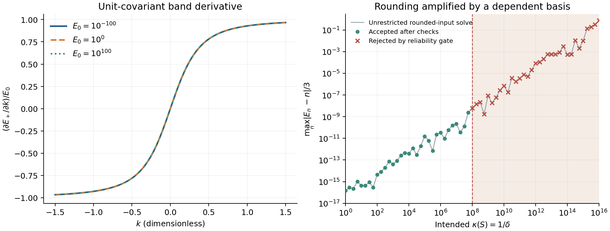

# 非正交轨道谱：条件数、简并尺度和换基

本分支从远端 main `13a5832df636c68839b59859adbc330567a02121` 开始。
官方 MATLAB 唯一基线仍为 BUAA-TCMP/TBkit @
`48e5217593598c8e1d634cdee3976e1dc6984516`，本轮不更新 pin。
main 和 PR #2–#10 已分别检查，均不自动合并。

## 物理对象及两类阈值

普通非正交轨道的 `H c=E S c` 中，H 为算符二次型、S 是**正定厄米 Gram 矩阵**，
列向量满足 `C† S C=I`。若基矢按 B 重组，必须同时变换
`H'=B† H B, S'=B† S B`；物理谱不变，原坐标本征矢为 `c=B c'`。
这里不提供不定度量玻色 BdG、自动删基、非正交 Berry 连接或群速度公式。

原始 Python `band_gradient` 固定用 `gap_tol=1e-9` 判断简并。
`H(k)=E0*k*sz,S=I,k=.2` 的两条能带互不简并，斜率为 `[-E0,E0]`；
但 E0 从1变为1e-20后，旧代码报简并。能量单位不应改变单带导数是否有定义。
新默认阈值为本点**整个能谱带宽**的 `1e-9`，精确简并始终拒绝。
显式 `gap_tol>0` 仍是输入能量单位的绝对阈值，并关闭默认相对项；
若同时指定 `gap_rtol>=0`，使用 `max(gap_tol,gap_rtol*bandwidth)`。
采用缩放后的安全差值，避免极大能带间距相减溢出；相近有限能量先相减再缩放，
保留可表示的小差。能量零点/单位不变性均受输入自身舍入精度限制。

简并分辨阈值与 **Gram 条件数**是不同的限制。令
`B=diag(1,1,sqrt(delta))*Q`，Q 为固定正交矩阵，
理想精确算术给出 `S=B†B, H=B†diag(1,2,3)B` 的谱 `[1,2,3]`。
原始代码对 delta=1e-16 的一次执行返回约 `[1,2,5.33333333]`。
**这不证明 LAPACK 错解了输入的浮点矩阵铅笔**：H/S 形成时的舍入已被病态基底放大，
浮点矩阵可能不再表示原始精确模型。小求解残差也不能恢复丢失的信息。
缺少条件数说明和拒绝机制，才是这里修正的可靠性问题。

## 正定域、数值保护和接口边界

`NonOrthogonal.spectrum(k, condition_limit=1e8, check_tol=1e-8)` 提供只读、调用者持有的
批结果，包含 k、能量、输入基底中的本征矢、`lambda_max(S)/lambda_min(S)` 估计、
逐带范数残差和 Gram 框架误差。全程不使用跨模型可变缓存。
`bands` 保留原有单点/批量形状、列本征矢与可写返回数组；新增数值保护参数可显式设置。

1. H、S 和导数都显式要求零绝对厄米容差。main 的旧 helper 是逐元素相对检查；
   PR #10 的共享 Frobenius 判据提供一致的幺正基底策略，组合验证另记。
   本分支不复制或覆盖 PR #10 的稠密/稀疏检查实现。旧 helper 在接近精确零的元素上
   可能更严格，遇到有舍入残差的有效输入会拒绝；不通过暗中厄米化放宽它。
2. H、S 分别按有限实/虚分量尺度归一化，再求正定域及 Gram 特征值比。
   `lambda_min<=0` 拒绝；条件估计超过预算也在广义求解前拒绝。
   条件预算对共同归一化不变，但任意非幺正换基本来会改变矩阵条件数。
3. 默认条件预算是显式准确度门槛，**不是严格前向误差界**。
   `eps*condition_limit≈2.2e-8` 只表示误差放大尺度；维数、输入误差和谱间隔仍重要。
   放宽预算是一项需研究者决定的精度取舍，不代表不可靠输入已被修复。
   对角型 S 即使病态，也可能精确可解；可以显式放宽并检查报告，不自动删掉小本征值。
4. 归一化问题完成后，逐带检查
   `r_n=||Hc_n-E_n S c_n||₂ / ((||H||F+|E_n| ||S||F)||c_n||₂)`，
   并检查 `||C† S C-I||F`，两者必须有限且不超过 check_tol。
   这些量在缩放单位计算，与原单位定义在精确算术下一致。
5. 用二进制 mantissa/exponent 恢复物理能量，避免先形成 Hscale/Sscale 的溢出。
   非零能量若溢出或下溢成0，明确报错；不以零、Inf/NaN 冒充有效能带。
   本轮没有为所有极端尺度的导数消去设计高精度算法；导数非有限时拒绝。

可从用户 `@njit` 调用 `generalized_kernels.generalized_diagnostics(H,S,E,C)`，
输入是已验证的归一化 `(nk,n,n)` complex128 与 `(nk,n)` float64 数组。
对象校验、条件谱和广义对角化仍由 Python/SciPy/LAPACK 完成。
独立 NumPy 范数/矩阵乘法参考保留在 `generalized_diagnostics_numpy`。
内核不启用 fastmath；小块采用融合循环，大块保留 BLAS。线程由环境和 BLAS 配置控制。

## 独立验证

- 复数、非幺正但适度条件的 B：两带闭式谱 `±sqrt(k²+.4²)`，回到物理基底后
  对照解析谱投影，不比较不定的单列相位。能量单位和共同轨道归一化分别跨多个数量级。
- 动量依赖 `B(k)=diag(1+.3k,1)`：H、S 的解析多项式独立构造；
  `c†(dH-E dS)c` 的 dS 项必须抵消基底导数，恢复 `[1,-1]`，而非普通正交期望值。
- 对角型病态 Gram 的预算拒绝/显式放宽、旋转近相关基底的求解前拒绝；不把预期谱3
  强加给已经舍入的极病态矩阵。人为扰动求解结果以验证残差和 metric 门确实会报错。
- 2/8/9/32 维 Fourier 解析本征框架覆盖小矩阵分支两侧、Numba 嵌套调用、非零诊断误差。
- 只读快照与可写 bands 兼容、chunk 等价、参数域、精确简并、带宽/能量零点、
  次正规共同尺度、非零能量溢出/下溢明确拒绝。

## 官方 MATLAB 原式：Umat 未同步作用于 S

固定原始 `@HR/EIGENCAR_gen.m` 在 UmatMode 中执行 `Hout=Umat\Hout*Umat`，
随后截取 H 子块；该块没有 Sout 变换，随后直接 `eig(full(Hout),full(Sout))`。
两条静态/动态 U 分支都可见这种源码结构。专项测试仅抽取原始**完整静态 U 块**与
真实广义 eig 语句，在 Octave 中执行，不运行完整 HR 类或 Symbolic Toolbox。

令 `H=diag(1,3), S=diag(1,2), U=[[0,1],[1,0]]`。U 为严格幺正，原谱为 `[1,1.5]`。
原始 U 块只交换 H，S 不变，得到 `[.5,3]`；独立同时变换 Gram 后恢复 `[1,1.5]`。
这个反例不依赖 U 的非幺正歧义、舍入或厄米化选项。若意图是保持同一物理系统的换基，
只动 H 就改变了广义问题。若意图是另一个算符而保持固定 S，则它不属于这种换基。
子块投影还应同步处理 S；本轮只记录这一源码风险，未验证全部投影/动态 U 工作流。

本轮**不新增 MATLAB 候选补丁**，不修改原始参考、既有候选补丁或官方 pin。
物理一致的参考算例不等于完整 MATLAB 类修复已验证。

## 复现命令与接续

```bash
export PYTHONPATH="$PWD/python" NUMBA_NUM_THREADS=2 OPENBLAS_NUM_THREADS=1
python python/tools/prepare_upstream.py
python -m pytest python/tests/test_generalized_spectra.py python/tests/test_matlab_overlap_basis.py -q
python python/examples/nonorthogonal_reliability.py --output work/nonorthogonal
python python/benchmarks/generalized_diagnostics.py
python python/tools/validate.py --output work/nonorthogonal-validation --benchmarks
```

重建环境沿用 `python/install.sh`；不安装商业 MATLAB。研究例子输出 PNG/SVG 与
未经画图截断的 NPZ。图中的数值零仅在绘图副本上设下限，原数据原样保存。
病态误差曲线是未限制的浮点求解观测，不充当精确物理参照；精确参照来自合同变换恒等式。

后续：更严格的条件数/输入误差传播、广义简并子空间的方向微扰、完整非正交连接与
速度/响应，以及 MATLAB Umat 的完整类兼容修复。接续还需审查 H/S 晶格元数据容差。
不将本次普通正定 Gram 谱检查推广为所有非正交研究流程已完成。


## 本轮实际结果（2026-11-18）

- 独立 main 分支：178 项测试、12 个验证步骤（含4项基准）全部通过，失败/错误/跳过均为0。
  本轮新增37项回归。原有 Fortran/Octave 测试继续执行；没有重装商业 MATLAB。
- 与 PR #2–#10 临时组合后：375 项测试、27 个步骤（含9项基准）全部通过，仅1条
  Matplotlib/Pyparsing 依赖弃用警告。8个共享文档/导出/内核追加/任务注册文件手动保留
  各分支内容，精确 head SHA、策略及新数值源码hash见 `nonorthogonal-integration-validation.json`。
  这不是远端合并或正式发布；临时工作树已恢复干净。
- 研究例子带梯度归一化后的最大绝对误差 `4.44e-16`；65个基底扫描点中32个通过，
  33个被拒绝。PNG/SVG 已实际检查，原始 NPZ 可重建。条件预算不是小劈裂精度认证。

首版基准保存在 `generalized-diagnostics-benchmark-before.json`：两个负载的 Numba
约.948/6.65毫秒，NumPy约.731/4.98毫秒，Numba较慢。验证后减少小矩阵的BLAS调度，
并将规范化输入的复数平方模改为分量平方和，避免 hypot 后再平方；8/9维边界独立回归通过。
最终 `generalized-diagnostics-benchmark.json` 保存每次墙钟与进程CPU样本：
512×4诊断约.317/.939毫秒（Numba/NumPy），64×32约2.69/8.21毫秒，约2.96/3.05倍。
最大残差比差约8.24e-17、Gram误差差约4.08e-16；新 dispatcher 编译+首次调用约2.94秒。
Numba配置2线程、BLAS1线程，内核本身串行，不启用fastmath。

完整 spectrum 流程另计模型读取、条件谱、广义对角化、检查和只读结果：64点负载约
9.84/9.71毫秒与59.02/61.77毫秒（Numba/NumPy），整体速度接近，不能外推3倍。
它还承担旧程序没有的可靠性检查，不能将它与无检查算法混作同功能性能比较。
云端墙钟波动与所有样本均保留，不宣称相对 MATLAB 或全工具包的固定加速。


