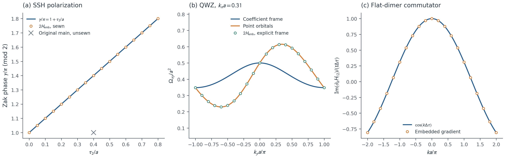

# 点轨道规范经过模型代数后的物理审计

本轮基于远端 main `a1f1102356d4efb8df50d7bf4bc70810adf5a38f`。
接续时 PR #13 为唯一未合并 PR，head `e6c8f6374e3f3aff3a947bb18a98b1f88716f574`；
其远端 CI run 44650352140 已 success，仍未自动合并。
本分支从 main 独立开发，不把 #13 的长度单位改动当作已经发布。

## 原始 Python 反例

在修改任何 Python 源码之前执行当前 main，四个涉及文件的 SHA256 和实际结果
存于 `gauge-python-pristine.json`。

1. SSH 的两个分数中心为0和0.4，胞长1，t1=0.6，t2=1。手性两带模型上下带的
   两个轨道权重均1/2。采用 `A=i<u|du>`，系数 Zak 相位为 pi，加入位置连接后
   `gamma=pi+2*pi*(0+0.4)/2=1.4*pi (mod 2*pi)`。
   `2*embed_orbitals(model)` 不改变本征子空间，原式却丢失 sewing 要求，
   允许错误的首尾直接闭合，实际返回 pi。正确值为 -0.6*pi，约差1.25664弧度。
2. QWZ 模型两个中心为(0,0)、(0.37,0)。缩放后的嵌入对象被视为普通类，
   `prepare_geometry(...,frame='point-orbital')` 再次加入位置项。
   两个指定探针的 Berry 曲率最大偏差约0.1190492891；不是相位选取引起的差别。
3. 混合系数/点轨道框架的相加被接纳，默认 allclose 也把0.4与0.40000001的中心
   当作相同。相同数值矩阵维度不足以证明同一 Bloch 基底。
4. `boundary_sewing([2*pi*1000000.25])` 被默认相对容差当成整数倒格矢。
   这类错误不能通过扩大 k 回路来减小，必须收紧维度无关的整数检查。

旧版直接双重嵌入的局部导数也会重复位置项；其历史 phase 字段仅记录原始代码
实际传入一次 sewing 的结果，不将该不一致闭合当作正确的双嵌入参考。

## 数学与修复

点轨道框架 `H_emb=D† H D`，`D_jj=exp(i k.tau_j)`。
`dH_emb=D†[dH+i(H tau-tau H)]D`。用独立实空间算符 `v=i[H,r]`、hbar=1，
胞内平坦二聚体 `H=t*sigma_x` 的上非对角元导数为
`i*t*Delta_tau*exp(i*k*Delta_tau)`；SymPy 直接对精确矩阵求导，与三个后端对照。

采用显式 `orbital_frame` 标记而非 `isinstance(OrbitalEmbedding)`，模型代数保留
框架与 sewing，拒绝不同框架混用；同框架和中心的 sewing 才能委托给首个模型。
工厂嵌入幂等；直接重复构造明确报错。共用有限实分数中心检查，不静默删虚部或包裹。
中心 atol=1e-12、rtol=0；倒格矢整数检查 atol=1e-10、rtol=0；Wilson 外部 sewing
的幺正检查 atol=1e-10、rtol=0。给出容差不等于认证任意大浮点相位的精度。

`_periodic_bz` 显式拒绝要求 sewing 的模型，即使原子极限的采样 H(k) 恰好周期。
没有实现完整带 sewing 的二维拓扑算法，也未将投影 mirror sector 问题标为完成。

准备层与纯数组数值层分开，新增两个 nopython dressing 内核。NumPy 的独立广播
实现保留。各 k 点独占输出，不做跨线程规约，不缓存模型，不投影不正确的输入。
Fortran 计算底层 Fourier，嵌入由 NumPy 处理。完整 API 与准备好的数组分开计时。

## 独立验证与官方 MATLAB

- 精确 SymPy 指数矩阵求导、实空间位置对易子、NumPy/Numba/Fortran；
- SSH 解析 Zak 相位、缩放/负号/相加/相减/嵌套对象、sewing 协变与组合；
- QWZ `Delta Omega_xy=-tau_x*d_y p_2` 的解析公式和不重复位置项；
- 两个平坦二聚体的简并占据子空间，任意逐点 U(2) 混合后 holonomy 谱保持；
- 有限性、框架/中心不匹配、非整数大倒格矢、非幺正 sewing、真正 @njit 组合与输入不变性。

唯一官方参考仍为 BUAA-TCMP/TBkit @ `48e5217593598c8e1d634cdee3976e1dc6984516`。
逐字运行原始 `@HR/fft.m` 四输出数值主体，仅移除 Octave 不支持的 arguments 块、
重命名函数，使用已存在的 tensorprod 适配器；每个新进程只调用一次，避免混入缓存问题。
平坦二聚体实际证明原始位置项恰为 `i[H,r]` 的相反数。这是已记录 M-07 的独立简例
复核，不冒称新发现，也不把测试重现错误写成官方原式正确。

原始 `@HR/plus.m`、`mtimes.m` 的元数据拷贝与入口只作源码审阅，未运行完整类，
不能据此认证所有原对象代数。原始源码与既有候选补丁分开；本轮不新增 MATLAB 补丁，
不改变 pin，未安装商业 MATLAB。源码 hash 与执行边界见 `gauge-matlab-reference.json`。

## 复现与接续

```bash
export PYTHONPATH="$PWD/python" NUMBA_NUM_THREADS=2 OPENBLAS_NUM_THREADS=1
python python/tools/prepare_upstream.py
python -m pytest python/tests/test_orbital_gauge_algebra.py python/tests/test_matlab_orbital_velocity.py -q
python python/examples/orbital_gauge.py --output work/orbital-gauge
python python/tools/validate.py --output work/gauge-validation --benchmarks
```

研究例子保存 PNG/PDF/SVG、未修改 NPZ 与误差 JSON；历史错误点来自实际 main 快照。
图中模型能量缩放不改变占据态的几何；系数框架和点轨道框架的局部曲率并非同一量。
只讨论正交点轨道，不从 hr.dat/中心推断完整 Wannier 连接；极化的离子背景与原点
需另行指定。一般非正交连接、镜面投影 sector 的 sewing、带 sewing 的二维网格、
结构化符号实空间存储仍列接续，880 个官方文件尚未完成迁移。

## 本轮完成记录

新增26项回归，完整401项测试全部通过，失败/错误/跳过均为0；29个步骤全部成功，
包含所有研究例子与10项基准。唯一警告为Matplotlib/Pyparsing依赖弃用。
报告及10个被测文件hash见 `gauge-validation.json`，原始日志在 `work/gauge-validation/`。
Zak单位圆误差约8.01e-16，点轨道曲率缩放误差约6.66e-16，QWZ解析修正误差约6.11e-16。
PNG已实际查看并调整图例以避开曲线；PDF/SVG和NPZ由脚本输出。

固定种子20261121、1024个k点、15个实空间项、Numba 2线程、BLAS1线程；
新dispatcher编译加首调用H/gradient约1.72/1.65秒。预热5样本中位数如下，
保留全部墙钟/进程CPU样本于 `gauge-backend-benchmark.json`：

| 轨道数 | 数组Numba/NumPy H+gradient | 完整Numba/NumPy API H+gradient |
| --- | --- | --- |
| 8 | 0.710 / 5.169 ms | 6.271 / 11.395 ms |
| 32 | 24.359 / 62.039 ms | 144.730 / 100.894 ms |

数组误差H不超过1.35e-14、gradient不超过2.13e-14。
完整API计入底层Fourier和对象准备；32轨道NumPy更快。未更改全局调度，也不声称
普遍加速或快于MATLAB。正交点轨道范围外的物理假设和接续条目保持未完成。


