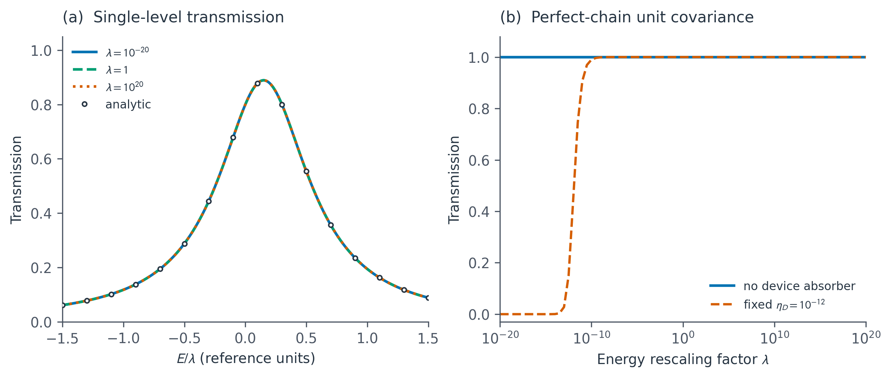

# 输运：能量单位、额外吸收与因果性

官方基线：BUAA-TCMP/TBkit @ `48e5217593598c8e1d634cdee3976e1dc6984516`。
Python基线：pyTBkit main `13a5832`；本轮独立于未合并的符号PR #2和绘图PR #3。

## 物理定义与必须成立的性质

引线上三角块为V，半无限链第一个主层的retarded Green函数满足

`g(z) = [z I - H00 - V g(z) V†]^-1`, `z=E+i eta`。

这里E为实数、eta>0、H00厄米；`i(g-g†)`应为非负半定。
反向表面使用V†。对正的单位换算因子lambda，把H、V、E、eta、自能和任何
设备展宽一起乘lambda，应有`g -> g/lambda`、无量纲透射率T不变。
同时把E和onsite增加同一个实数能量参考，也不应改变结果。

两端口相干弹性输运采用Caroli公式：

`T = Tr[Gamma_L G Gamma_R G†]`, `Gamma=i(Sigma-Sigma†)`。

自能已按device轨道基底嵌入；没有自旋简并、e²/h或额外电导单位的隐含因子。

## 已复现的Python反例

| 旧行为 | 解析判据与修复 |
| --- | --- |
| 引线消元用绝对1e-12的跃迁截止，t=1e-20、eta/t=1e-6时修正失败 | 将E I-H、V、eta一起无量纲化；迭代截止、Riccati与retarded检验均在该空间执行，最后g除回能量尺度 |
| 理想单点链默认额外设备展宽1e-12，t=1e-12时T约0.4444443 | 移除隐含吸收：transmission默认eta=0，chain_transmission增加显式device_eta=0 |
| Sigma_L=+i*1e-12、Sigma_R=-i*1e-12被绝对PSD阈值接受，设备eta=1e-13时返回T=-400 | 各Gamma以自身幅度归一化后判断PSD，只容许相对浮点舍入；此输入明确报错，不取绝对值伪装成透射率 |
| 小能量单位下非厄米onsite或缺失反向HR跃迁被容差放过 | 从onsite移除无关的实数单位矩阵部分后相对检查厄米性；正反跃迁相对比较，不做隐式厄米化 |

单链E=0时，令`eta/t=epsilon`、`r=(sqrt(epsilon²+4)-epsilon)/2`，有
`Sigma_L=Sigma_R=-i*t*r`。无额外设备吸收时T=1；若额外加入eta_D，
则`T=4(t r)^2/(2 t r+eta_D)^2`。因此eta_D是改变结果的参数，不能隐藏成固定
“数值小量”。示例的固定吸收曲线使用这个独立公式，不是把旧消元器的失败结果补齐。

## 原始MATLAB的单独验证

`src/classes/@TBkit/GW_iter.m`直接判断`norm(M3+M4,'fro')<infinity_small`，
默认阈值1e-10有能量量纲。对`w/t=.3, eta/t=1e-6`，将t从1改为1e-20，
首轮就满足该绝对阈值，返回

`t*g = 1/(z-1/z)`, `z=.3+i*1e-6`，

而正确根为`(z-sqrt(z²-4))/2`。原式结果的无量纲Riccati残差大于1，
不是普通舍入误差。`test_matlab_transport_audit.py`在Octave运行原函数，
仅移除不兼容的MATLAB arguments验证块，显式传入全部六个参数；方程和分支不改。

该测试通过意味着**成功复现原式缺陷**。本轮没有修改官方checkout，也没有为
GW_iter加入候选补丁；现有official-fixes.patch里的其他修复仍单独验证。
Tmatrix_iter/Tmatrix2Green00、bulk输出和全部引线算法尚未在本轮完成审阅。

## 接口与算法变化

- `surface_green(..., tol=...)`的tol现在明确为无量纲阈值。内部存储逆Green块，
  使用E I-H作为尺度依据，避免任意绝对能量原点影响消元精度。
- `transmission(..., eta=0.)`默认不增加设备吸收；需要额外展宽时显式给出eta。
- `chain_transmission(..., eta=..., device_eta=0.)`分别控制引线与设备展宽。
  正的设备展宽是吸收项；不能因此期待纯两端口的理想T=1。
- 所有能量和展宽要求有限实标量，onsite/自能/跃迁要求有限矩阵；不静默丢虚部。
- 保留SciPy/LAPACK求解器与小主层Newton修正。没有新增全局模型缓存，没有声称
  此矩阵求解路径变成Numba内核，也没有根据正确性修复宣称性能提升。

## 验证与边界

独立判据包括正/负能量及带内/带外/带中心的单链解析根、单能级共振透射公式、
160层双轨道有限开链的直接矩阵求逆、复数跃迁方向、基底幺正旋转、能量原点平移，
以及低秩展宽的Frobenius范数表达式。能量换算因子覆盖1e-20到1e20。

```bash
python -m pytest python/tests/test_transport_scaling.py python/tests/test_matlab_transport_audit.py -q
python python/examples/transport_scaling.py --output work/transport-scaling
python python/tools/validate.py --output work/transport-validation
```

示例导出PNG/PDF/SVG与原始数值数组。由于绘图PR #3尚未合并，此独立分支的例子
直接使用局部Matplotlib样式；后续合并后再统一接入公共plot_style，不引入隐藏依赖。



仍需逐体系收敛eta；有限eta的带外尾部不能直接当成真实传播通道。设备eta=0时，
完全与引线解耦的束缚态若恰好位于求解能量可使逆矩阵奇异，须显式处理其物理极限。
大于16轨道的主层在Riccati残差超限时仍明确报错；更大主层的修正、极小eta的
条件数控制、散射/多端口与非正交输运仍待进一步实现和验证。
